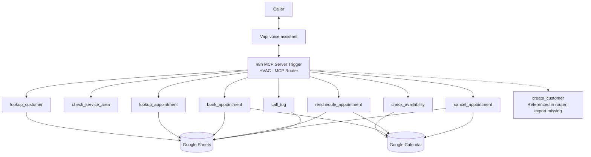

# HVAC AI Receptionist — Vapi + n8n MCP

> **Reference project** for an AI receptionist serving a fictional residential HVAC company. The repository contains n8n workflow exports that connect an MCP tool router to customer, service-area, appointment, and call-log operations. **It is not a turnkey or production-validated deployment.**

Built to demonstrate how an AI voice agent can handle common HVAC phone inquiries while keeping customer records in Google Sheets and appointments in Google Calendar.

## Overview

An HVAC caller may ask whether the company services their ZIP code, request an AC/heating visit, check an appointment, reschedule or cancel, or ask for a staff member. **Vapi is the conversational interface; n8n exposes tools; Google Sheets and Google Calendar supply demo records and scheduling.**

The files currently in this repository implement **an n8n MCP router and eight exported child workflows**. Vapi assistant settings and its complete system prompt are **not included in the repository**; configure them separately in your Vapi workspace.

### Architecture



## Repository contents

All paths below are at the repository root (including the spaces in filenames).

| File | What it does |
| --- | --- |
| [`HVAC - MCP Router.json`](HVAC%20-%20MCP%20Router.json) | MCP Server Trigger and connections to the tool workflows. |
| [`HVAC TOOL - lookup_customer.json`](HVAC%20TOOL%20-%20lookup_customer.json) | Validates an email, reads the `Clients` sheet and returns matching records. |
| [`HVAC TOOL - check_service_area.json`](HVAC%20TOOL%20-%20check_service_area.json) | Compares a caller's ZIP code with a hardcoded demo ZIP allowlist. |
| [`HVAC TOOL - check_availability.json`](HVAC%20TOOL%20-%20check_availability.json) | Reads Google Calendar events and returns busy time windows, not a complete bookable-slot engine. |
| [`HVAC TOOL - book_appointment.json`](HVAC%20TOOL%20-%20book_appointment.json) | Validates a request, creates a Calendar event and appends an appointment record in Sheets. |
| [`HVAC TOOL - lookup_appointment.json`](HVAC%20TOOL%20-%20lookup_appointment.json) | Finds appointment records associated with an email in the `Appointment Log` sheet. |
| [`HVAC TOOL - reschedule_appointment.json`](HVAC%20TOOL%20-%20reschedule_appointment.json) | Updates a Calendar event and attempts to synchronize the appointment log. |
| [`HVAC TOOL - cancel_appointment.json`](HVAC%20TOOL%20-%20cancel_appointment.json) | Deletes a Calendar event and attempts to synchronize the appointment log. |
| [`HVAC TOOL -  Call Log.json`](HVAC%20TOOL%20-%20%20Call%20Log.json) | Normalizes a call summary and appends a row to the `Call Log` sheet. Note the **two spaces** after the hyphen in the filename. |

The router exposes **nine tool connections**, including the missing `create_customer` workflow; only **eight tool exports** are present alongside the router.

## Supported demo use cases

- Identify an existing customer by email.
- Check whether a ZIP code belongs to the example service area.
- View busy windows from a designated demo Google Calendar.
- Create a demo appointment for a service type and customer.
- Look up, reschedule, or cancel an existing appointment.
- Record a call summary in Google Sheets.
- Support HVAC-specific dialogue in **Vapi**, if a properly configured Vapi assistant prompt and escalation rules are supplied.

The JSON workflows **do not by themselves implement** an emergency-dispatch system, customer-facing transfer routing, diagnosis, pricing, warranty decisions, a complete FAQ knowledge base, or automatic Vapi end-of-call webhook ingestion. Those behaviors need separate Vapi configuration and/or additional workflows.

## Prerequisites

1. A running n8n instance with **MCP Server Trigger** and **Call n8n Workflow Tool** support.
2. A Vapi account with an AI voice assistant and a supported MCP tool connection.
3. Google account credentials authorized in n8n for **Google Sheets** and **Google Calendar**.
4. A dedicated **demo** Google Sheet and Calendar, separate from real business operations.
5. A reachable, HTTPS-enabled n8n MCP endpoint and the authentication method supported by your n8n deployment.

Vapi usage, hosting, phone numbers, and LLM/voice services may incur costs.

## Setup

### 1. Create the demo Google data

Create a spreadsheet with at least these worksheets (match headers to the imported node mappings):

**`Clients`**

```csv
Email,Name,Phone,Customer ID
jordan.test@example.com,Jordan Test,+16025550101,CUST-DEMO-001
```

**`Appointment Log`**

```csv
Appointment ID,Calendar Event ID,Customer ID,Email,Service Type,Start ISO,End ISO,Status,ZIP,Notes
```

**`Call Log`**

```csv
Call ID,Caller Phone,Customer ID,Summary
```

Use synthetic data only. The current booking export produces some keys such as `StartTime` and `EndTime`, whereas the Google Sheets mapping expects `Start ISO` and `End ISO`; **align these before a booking test**. Also inspect the appointment cancellation and rescheduling mappings to avoid incorrect row changes.

Create a separate Google Calendar for sample HVAC service appointments. Choose one demo company timezone (for example, `America/Phoenix`) and use explicit ISO 8601 timestamps with offsets in test requests.

### 2. Import the child workflows into n8n

In n8n, use **Import from File** for each `HVAC TOOL - ...json` file. Open the imported workflows and:

- Replace existing spreadsheet and calendar references with **your** demo resources.
- Select or create your own Google credentials in each Google node.
- Check Code-node input and output shapes against the tool payloads you will send.
- Verify Google Sheets column mappings and any auto-mapping behavior.
- Run every child workflow with synthetic inputs before exposing it through MCP.
- Create/export the missing **create_customer** child workflow if new customer onboarding is part of your demo.

**Imported workflow IDs are environment-specific.** They will not automatically correspond to the IDs referenced in the router export.

### 3. Import and relink the MCP router

Import `HVAC - MCP Router.json`, then open every **Call n8n Workflow Tool** node. Select the corresponding imported child workflow in your instance. Remove or disable the `create_customer` tool until its missing workflow is available.

Review descriptions and schemas exposed to the voice assistant. Configure the MCP trigger's production URL and **actual supported authentication**; do not assume that an n8n API key alone is the correct bearer token for your MCP endpoint.

### 4. Configure Vapi

1. Create a Vapi assistant for a fictional HVAC company.
2. Provide an HVAC-specific prompt: greet callers, clarify service requests, collect minimal necessary details, check service area, check availability, and confirm appointment mutations only after a successful tool response.
3. Add the n8n MCP endpoint using Vapi's currently supported MCP transport and authentication settings.
4. Confirm the intended tool names and argument formats appear and are callable from the assistant.
5. Use a Vapi test call to exercise one read-only tool (customer lookup or service-area check) before enabling appointment mutations.

**Voice guidance:** The assistant must not invent availability, diagnose or instruct on dangerous repairs, promise emergency dispatch, or expose other customers' calendar information. Urgent health/safety situations should be directed to appropriate emergency assistance and/or a human according to the demo's explicit escalation policy.

### 5. Test booking and changes

Suggested sequence with a synthetic caller:

1. Check a known supported ZIP code.
2. Look up a synthetic customer.
3. Request a calendar time window and inspect busy periods.
4. Book an appointment only after validating a free slot under the demo rules.
5. Verify the Calendar event **and** matching Appointment Log row.
6. Find the record by its customer identity.
7. Reschedule to a separately checked available time and verify synchronization.
8. Cancel and verify that the Calendar and Sheet agree.
9. Log a call summary and inspect `Call Log`.

**The current exports have not been validated end-to-end in your accounts.** See the known limitations below before running live mutations.

## Representative payloads

The child workflows often accept data within a `query` field (sometimes as a JSON string). For example, the booking tool's validation checks for the following fields:

```json
{
  "query": {
    "startTime": "2026-12-01T10:00:00-07:00",
    "endTime": "2026-12-01T11:00:00-07:00",
    "email": "jordan.test@example.com",
    "serviceType": "AC repair",
    "zipCode": "85032",
    "customerID": "CUST-DEMO-001",
    "address": "Example address (synthetic)"
  }
}
```

This is a **representative input shape**, not a guarantee that the router or Google operations will succeed before node mappings are reconciled. Use test executions to confirm the actual request schema each MCP tool exposes.

The current service-area allowlist includes demo Phoenix-region ZIP codes such as `85032` and `85254`. Its input parsing is inconsistent across nodes (`zipCode` validation versus parsing the `query` field); reconcile that mismatch before relying on results.

## Known limitations and work remaining

These points are based on the current exported JSON files, not assumptions about your live n8n instance.

- **Missing child export:** `create_customer` appears in the MCP router, but the corresponding file is absent.
- **Router IDs:** Child-workflow references reflect the original n8n environment and must be relinked after import.
- **Service-area input mismatch:** The validator requires `zipCode`, while the ZIP extraction reads `query`; normalize this contract.
- **Availability semantics:** The calendar tool returns busy windows. It does not independently enforce staffed hours, job duration, travel buffers, or a robust race-safe hold before bookings.
- **Booking column mismatch:** Generated `StartTime`/`EndTime` fields do not directly match the mapped `Start ISO`/`End ISO` spreadsheet columns.
- **Cancellation log synchronization:** The exported Sheets operation is a row deletion, and the Calendar and Sheets branches are parallel. Confirm an exact row match and design failure recovery before use.
- **Reschedule synchronization:** Validate appointment ownership, re-check the target slot, and ensure a correct log row is updated rather than appended incorrectly.
- **Customer authorization:** Email-only lookup is insufficient proof of ownership for disclosing or changing an appointment; add caller verification for any real deployment.
- **Call logging:** The included call-log workflow is an MCP-invoked child workflow, not a standalone Vapi end-of-call webhook listener.
- **Staff transfer and emergency handling:** Not implemented by the exported n8n tools alone.
- **Reliability:** Add idempotency, error handling, retries, rate limits, and compensating actions for partially successful calendar/sheet writes.

## Security and data handling

- Use **demo credentials and fictional contacts**; do not upload live customers' personal information into a public repository.
- Never commit Vapi API keys, Google OAuth secrets, n8n tokens, phone provider credentials, or full unredacted call transcripts.
- Reconfigure imported Google document/calendar references and review exported node metadata before sharing workflows.
- Verify inbound tool authentication and apply minimum required permissions.
- Add authorization checks before appointment lookup, modification, or cancellation.
- Follow applicable consent, call-recording, data-retention, and emergency-communications requirements before real use.

## How to demonstrate it to an HVAC prospect

**Two-minute controlled walkthrough:**

1. **0:00–0:20 —** Call the Vapi demo receptionist and describe an AC problem.
2. **0:20–0:45 —** Provide a supported ZIP and let the agent run the service-area tool.
3. **0:45–1:15 —** Ask for an appointment; agent checks the demo calendar and offers only validated slots.
4. **1:15–1:40 —** Confirm a time and show the created Calendar event and Sheet entry.
5. **1:40–2:00 —** Show the corresponding call log and explain the human-escalation boundary.

Run this demo only after the setup and acceptance tests succeed. Frame the benefit as **faster call intake and consistent follow-up**, not a guaranteed increase in bookings.

## Project status

**Current state:** repository contains **9 n8n JSON files** (1 MCP router and 8 child workflows). The import artifacts demonstrate the intended architecture. The end-to-end Vapi connection and Google writes **have not been verified from this repository**, and the issues listed above should be resolved before a live demo or production pilot.

## References

- [n8n documentation](https://docs.n8n.io/)
- [Vapi documentation](https://docs.vapi.ai/)
- [Google Sheets API](https://developers.google.com/workspace/sheets/api)
- [Google Calendar API](https://developers.google.com/workspace/calendar/api)

## Author

Maintained by [NAIMNoamane](https://github.com/NAIMNoamane).

Repository: [AI-Receptionist-for-HVAC-companies](https://github.com/NAIMNoamane/AI-Receptionist-for-HVAC-companies)

---

*This project is a reusable reference implementation. Adapt the company's service area, policies, booking rules, voice prompt, and integrations before any client-specific deployment.*
